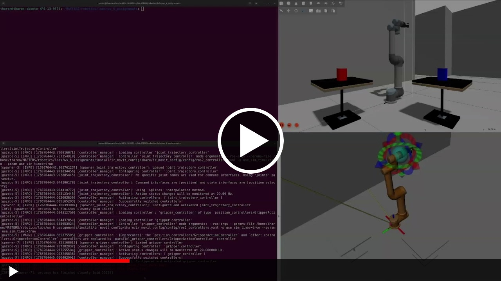
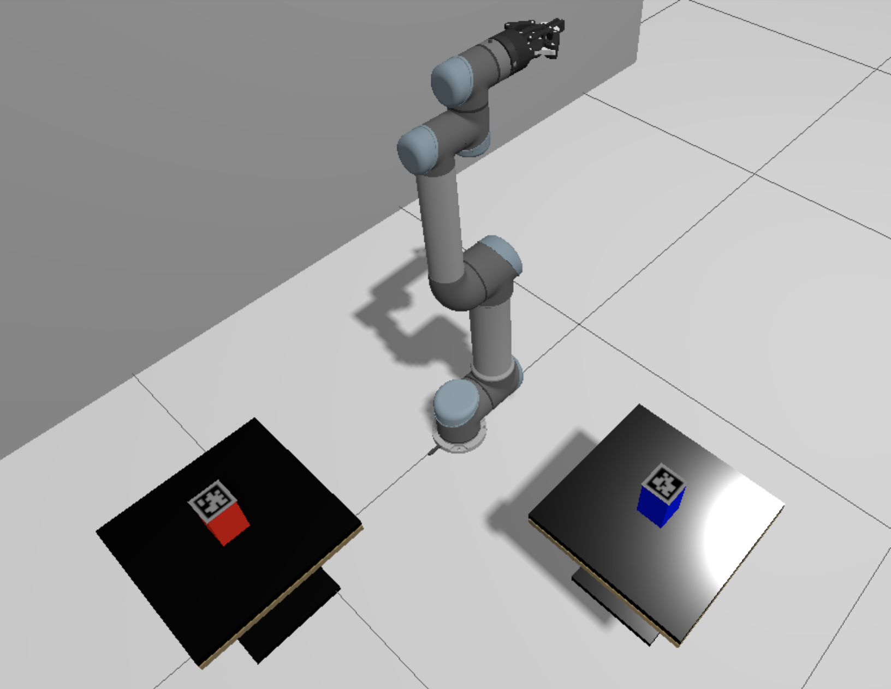
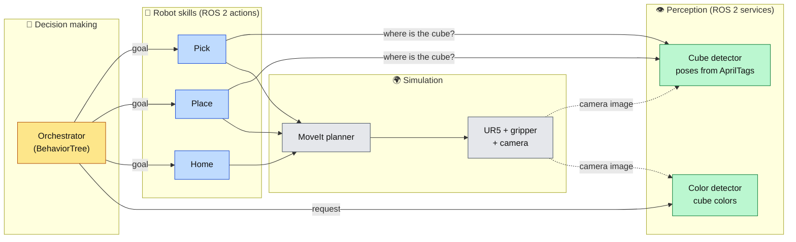
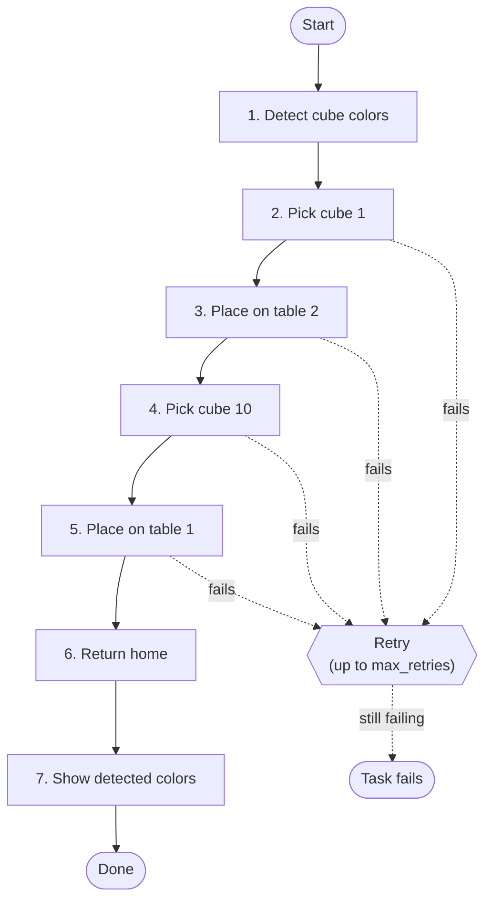

<div align="center">

# 🤖 UR5 Cube Swap

**A simulated UR5 arm that finds two cubes with AprilTags and swaps them between two tables, orchestrated by a BehaviorTree with automatic retries.**


<a href="https://drive.google.com/file/d/1EAvlPeIlvL5cCZah2a6z21FSKIIr2TdN/view?usp=sharing">
  
</a>

*Click to watch the demo video (opens Google Drive)*

</div>

---

## Overview

This project was built for *Intelligent Robotics* (MSc), Assignment 2. A UR5 arm with a gripper stands between two tables. Each table holds one cube with an **AprilTag** on top. The robot has to **swap the two cubes**, then go back to its home pose and report the cubes' colors.

<p align="center">
  
  <br>
  <em>The simulated scene: the UR5 sits between two tables. One table holds a red cube and the other a blue cube, and each cube has an AprilTag on its top face.</em>
</p>

**What the scene shows**

| Element | Role |
|---|---|
| UR5 arm with gripper | Picks up and places the cubes |
| Two tables | Source and destination for each cube (table 1 and table 2) |
| Red and blue cubes | The objects to swap; the color detector reports these |
| AprilTag on each cube | Lets the vision node compute the cube's 3D pose |

---

## Features

- **Vision-based grasping:** cube poses come from AprilTag detections, so cubes don't need to be at hard-coded positions.
- **Color detection:** reads each cube's color from the camera image.
- **Modular design:** pick, place and home are independent ROS 2 action servers that you can test one at a time.
- **Robust execution:** a BehaviorTree runs the task and retries any failed step.
- **Configurable:** grasp offsets, poses and retry counts live in YAML files.

---

## How It Works

### System at a glance



In short: the **orchestrator** decides *what* to do, the **action servers** know *how* to do it, **perception** tells them *where* things are, and **MoveIt** turns targets into safe arm motions.

### The task, step by step



Each of the pick, place and home steps is wrapped in a retry decorator. If a step still fails after `max_retries` attempts, the whole run fails. The tree itself is defined in [`behaviour_trees/swap_logic.xml`](behaviour_trees/swap_logic.xml).

### Building blocks

| Component | What it does |
|---|---|
| **Orchestrator** | Runs the BehaviorTree and calls the other components in order |
| **Cube detector** | Service `get_cube_poses`: turns AprilTag detections into cube poses |
| **Color detector** | Service `get_cube_colors`: returns each cube's color from the camera image |
| **Pick server** | Action `pick`: approaches, grasps and lifts the requested cube |
| **Place server** | Action `place`: puts the held cube on the target table |
| **Home server** | Action `home`: moves the arm to its safe home pose |
| **Test clients** | Small clients to trigger each action by hand |

### Interfaces

| Type | Name | Input | Output |
|---|---|---|---|
| Action | `Pick` | `cube_id` | `success` |
| Action | `Place` | `grabbed_cube_id`, `target_table_id` | `success` |
| Action | `Home` | *(none)* | `success`, `message` |
| Service | `GetCubePoses` | `target_ids[]` | `success`, `message`, `detected_ids[]`, `poses[]` |
| Service | `GetCubeColors` | *(none)* | `success`, `message` (e.g. `Cube 1: RED \| Cube 10: BLUE`) |

---

## Getting Started

### Prerequisites

- ROS 2 with `colcon`, **MoveIt 2** and **BehaviorTree.CPP v4**
- The course workspace packages **`ir_launch`** (simulation) and **`ir_movit_config`** (MoveIt configuration)
- Other dependencies: AprilTag (`apriltag_msgs`), OpenCV / `cv_bridge`, `tf2`, `image_geometry`

### Build

From your ROS 2 workspace:

```bash
colcon build --packages-select group_6_assignment_2
source install/setup.bash
```

> Source `install/setup.bash` in **every new terminal**.

### Run the full swap

**Terminal 1:** simulation and MoveIt
```bash
ros2 launch ir_launch assignment_2.launch.py
```

**Terminal 2:** detectors, action servers and orchestrator
```bash
ros2 launch group_6_assignment_2 orchestrator_full.launch.py use_sim_time:=true max_retries:=5
```

| Argument | Default | Meaning |
|---|---|---|
| `use_sim_time` | `true` | Use the simulation clock |
| `max_retries` | `5` | Attempts per pick / place / home step |

The launch file starts the nodes one after another with short delays, and the orchestrator begins about 8 seconds in, once the servers are ready. Watch its log for action feedback and retries.

---

## Testing Pieces Individually

Handy for debugging one step without running the whole task.

**Terminal 1:** simulation (as above)
```bash
ros2 launch ir_launch assignment_2.launch.py
```

**Terminal 2:** detectors and action servers, without the orchestrator
```bash
ros2 launch group_6_assignment_2 basic_a2_package.launch.py
```

**Terminal 3:** trigger an action with a client launch file…
```bash
ros2 launch group_6_assignment_2 pick_action_client.launch.py
ros2 launch group_6_assignment_2 place_action_client.launch.py
ros2 launch group_6_assignment_2 home_action_client.launch.py
```

…or send a goal directly:
```bash
# Pick cube 1
ros2 action send_goal /pick group_6_assignment_2/action/Pick "{cube_id: 1}" --feedback

# Place the held cube on table 2 (cube 1 must already be grasped)
ros2 action send_goal /place group_6_assignment_2/action/Place "{grabbed_cube_id: 1, target_table_id: 2}" --feedback

# Go to the home pose
ros2 action send_goal /home group_6_assignment_2/action/Home "{}" --feedback
```

---

## Configuration

| File | What it controls |
|---|---|
| [`config/orchestrator_config.yaml`](config/orchestrator_config.yaml) | Orchestrator settings such as `max_retries` |
| [`config/planning_configuration.yaml`](config/planning_configuration.yaml) | Home and active joint poses, table position, cube and tag sizes, grasp orientation and offsets, approach and lift distances |
| [`config/custom_tags_36h11.yaml`](config/custom_tags_36h11.yaml) | AprilTag (`36h11`) detector settings |

| Orchestrator parameter | Default | Meaning |
|---|---|---|
| `max_retries` | `3` in code, `5` via the launch file | Attempts per step |
| `enable_bt_logging` | `true` | Print detailed BehaviorTree tick and retry logs |
| `use_sim_time` | `true` | Use the simulation clock |

To tune grasping, edit `config/planning_configuration.yaml`, then rebuild so the installed copy is updated.

---

## Troubleshooting

| Symptom | What to try |
|---|---|
| Servers not found, nothing happens | Start the simulation (Terminal 1) first, and source `install/setup.bash` in each terminal |
| Not sure what is running | `ros2 action list` (expect `/pick`, `/place`, `/home`) and `ros2 service list` (expect `/get_cube_poses`, `/get_cube_colors`) |
| A step keeps failing | Raise `max_retries`, or run that step alone and read the feedback |
| `Place` fails when run alone | It needs a cube already grasped, so run `Pick` first |

---

## Repository Layout

```
├── action/            Pick, Place, Home action definitions
├── srv/               GetCubePoses, GetCubeColors service definitions
├── behaviour_trees/   swap_logic.xml (the task)
├── config/            YAML parameters
├── launch/            Launch files (full system, basic servers, test clients)
├── src/, include/     C++ node implementations and headers
└── docs/images/       README images
```

---

## Team Members

**[Dawit Andargachew Asmare](https://github.com/dawit-andargachew) · [Tharen Emmanuel Candi](https://github.com/tharencandi) · [Giuseppe Castellana](https://github.com/g-castel15)**

## License

Released under the [Apache License 2.0](LICENSE).
